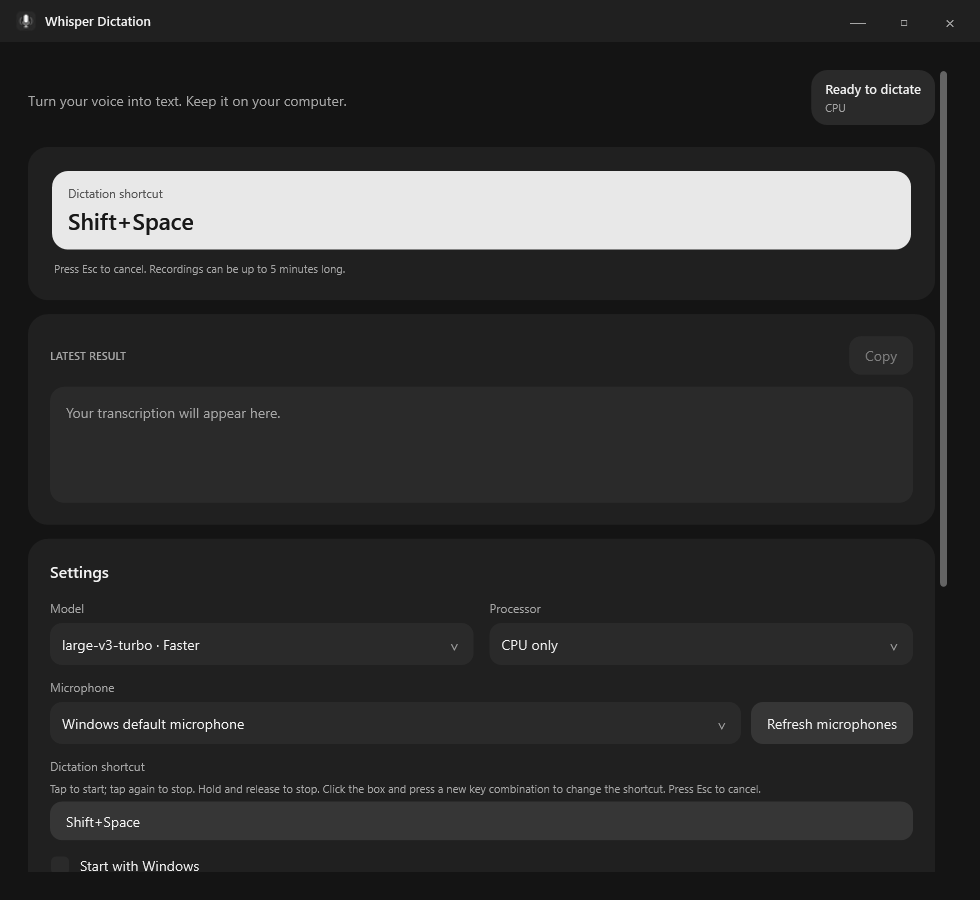

<div align="center">

# Whisper Dictation

**Private, offline speech-to-text for Windows.**

Speak into any app and get an English transcript without sending audio to a server.

[](https://github.com/kargalar/whisper-dictation/releases/latest) [](https://github.com/kargalar/whisper-dictation/releases/latest) [](LICENSE)

[Download for Windows ↓](https://github.com/kargalar/whisper-dictation/releases/latest) · [Build from source](#build-from-source) · [Report an issue](https://github.com/kargalar/whisper-dictation/issues)

</div>



## Speak and keep moving

Press **Shift + Space** to record, speak naturally, then press the shortcut again. Whisper Dictation transcribes locally and types the result into the focused app.

## Features

- Transcribe speech on-device with bundled Whisper models.
- Use the global shortcut in text fields across Windows apps.
- Keep audio off disk and transcripts in a local history.
- Run in CPU mode without a CUDA installation.
- Build an optional CUDA-enabled version from source.

## Download and run

Download all numbered parts of `WhisperDictation-win-x64.zip` from [Releases](https://github.com/kargalar/whisper-dictation/releases/latest), place them in one folder, and join them in Command Prompt:

```bat
copy /b WhisperDictation-win-x64.zip.001+WhisperDictation-win-x64.zip.002+WhisperDictation-win-x64.zip.003 WhisperDictation-win-x64.zip
```

Extract the archive into a writable folder and run `WhisperDictation.exe`. Wait for **Ready to dictate**, focus a text field, and press **Shift + Space**. Closing the window minimizes the app to the system tray; use **Quit** in the tray menu to exit.

## Build from source

Requirements: Windows x64 and the .NET 10 SDK. CUDA Toolkit 13 is only needed for a GPU build.

```powershell
dotnet restore WhisperDictation.slnx --locked-mode
dotnet build WhisperDictation.slnx
dotnet test WhisperDictation.slnx
```

See the release workflow for packaging commands and model assets.

## Privacy

Audio is processed in memory. Transcripts and settings are saved under the app's local `data` folder and are not encrypted; protect that folder with your Windows account.

## License

Whisper Dictation is licensed under the GNU General Public License v3.0. See [LICENSE](LICENSE).
